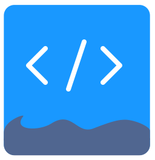

#  Codespace Like Helm Chart

Run a personal, browser-based development workspace on your Kubernetes cluster.

[](https://github.com/hoverkraft-tech/helm-chart-codespace-like/actions/workflows/main-ci.yml)
[](https://github.com/hoverkraft-tech/helm-chart-codespace-like/releases)
[](https://github.com/hoverkraft-tech/helm-chart-codespace-like/issues)

## Prerequisites

A Kubernetes cluster, a configured kubectl context, and Helm with OCI registry support.

## Install

Review [chart values](codespace-like/values.yaml), save your settings in `my-values.yaml`, then install:

```sh
helm upgrade --install codespace-like oci://ghcr.io/hoverkraft-tech/helm-chart-codespace-like/charts/codespace-like/helm-chart-codespace-like \
  --namespace codespace-like --create-namespace \
  --values my-values.yaml
```

## Development

Install Git, GNU Make, Docker with BuildKit, Helm, and kubectl.
Run `make lint`, `make lint-fix`, or `make lint '[.]github/'` from the repository root.
Open the repository in the dev container for the same tools and commands.

## Contributing

Open an issue or pull request to discuss changes.

## Maintainer

Maintained by [Hoverkraft](https://hoverkraft.cloud).
